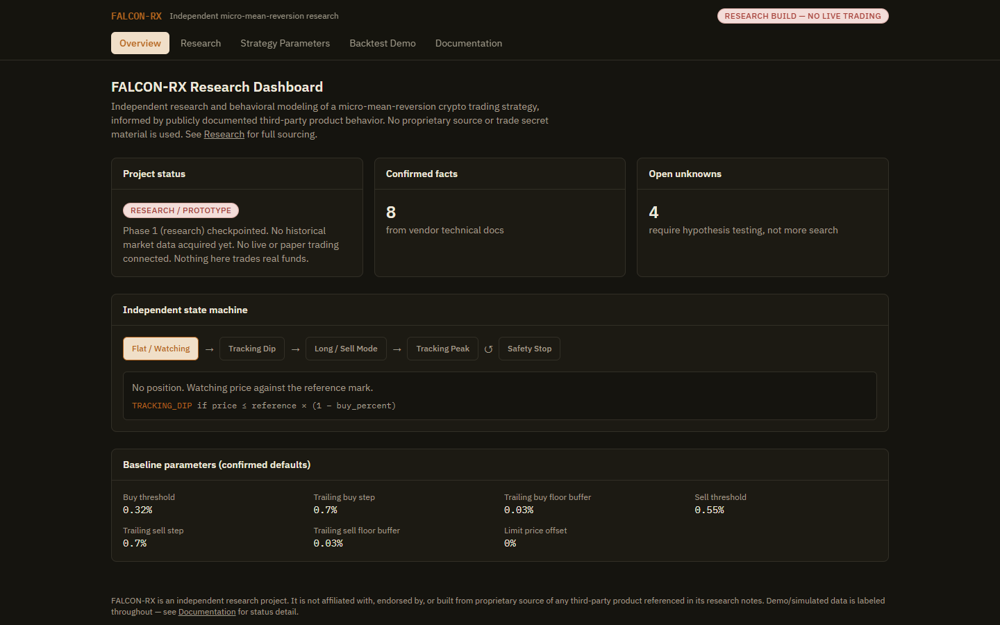
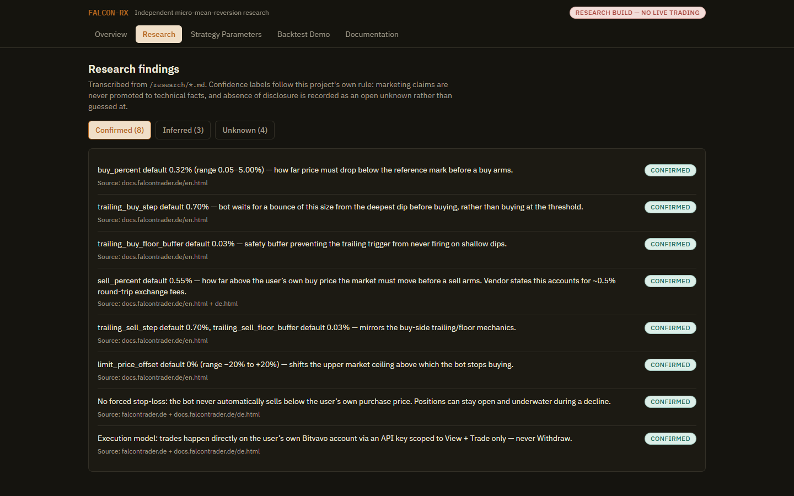
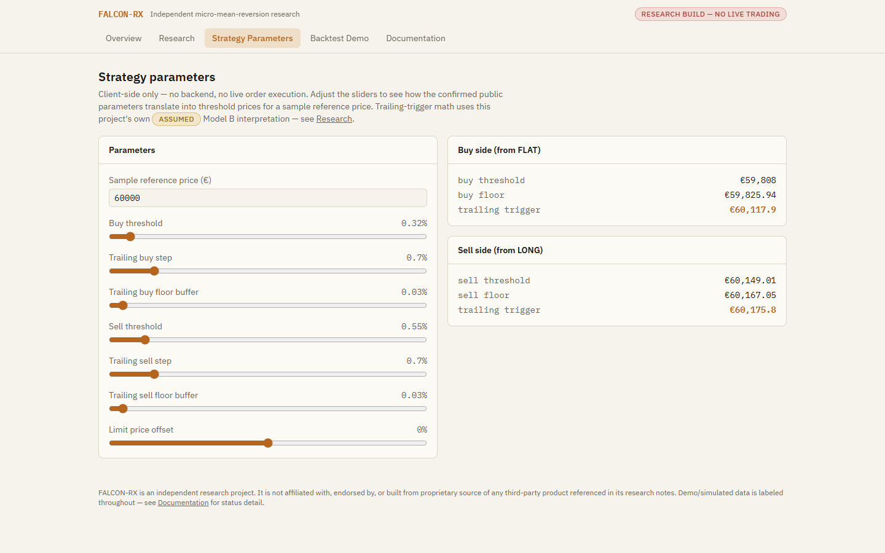
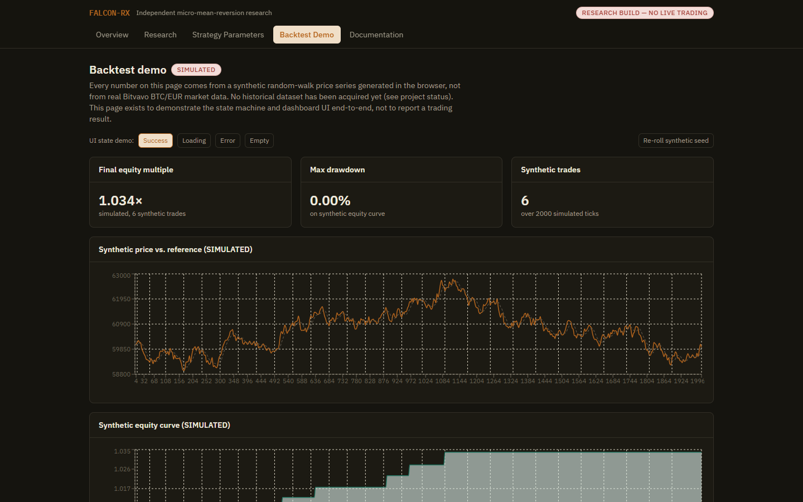
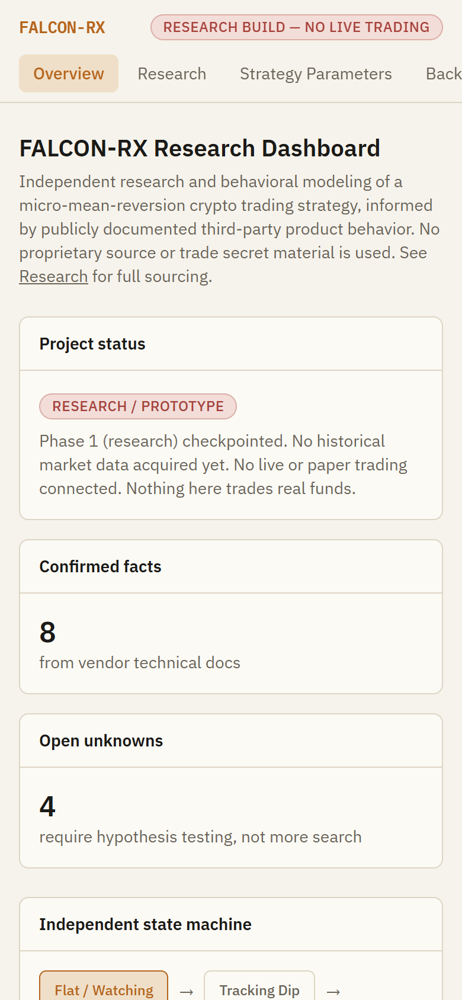

# FALCON-RX

**What can be proven about a marketed crypto-bot behavior from public sources alone — and an independent, testable engine built only on what was confirmed.**

**Status: Research / Prototype.** Not a working trading system. See [Honest Status](#honest-status)
below before reading anything else.

An independent research project studying a publicly-documented "micro mean-reversion" pattern in
retail crypto trading bots, and building an independently-named, independently-implemented engine
inspired by that public behavior — a confidence-graded research corpus, a formal strategy
specification, a state machine, a first-draft MetaTrader 5 EA, and a demo dashboard that ties them
together.



## Problem

Retail crypto trading bots often market a specific behavior ("buys small dips, sells small rallies,
never sells at a loss") without publishing the underlying algorithm. That makes the behavior
impossible to evaluate rigorously — you either trust the marketing or you don't. This project asks:
what can be determined about that behavior from public information alone, what has to remain an
open hypothesis, and can an independently-designed engine built around the confirmed parts be
validated against real data rather than taken on faith?

## Solution

1. **Research with confidence grading** — every claim is sourced and labeled CONFIRMED / INFERRED /
   UNKNOWN. Marketing copy is never promoted to a technical fact. See [`research/`](research/).
2. **A formal, independent specification** — [`docs/STRATEGY_SPEC.md`](docs/STRATEGY_SPEC.md)
   states exactly which numbers are vendor-confirmed defaults and which formulas are this
   project's own placeholder assumptions, pending hypothesis testing against real market data.
3. **A demo dashboard** that makes the research and the strategy math explorable, and demonstrates
   the state machine against synthetic (clearly labeled) data — see [Demo](#demo).
4. **A first-draft MT5 EA** ([`src/mt5/FalconLikeEA.mq5`](src/mt5/FalconLikeEA.mq5)) porting the
   same state machine to MetaTrader 5, with every assumption marked inline and the platform's real
   differences from Bitvavo documented in the file header.

## Features

- Interactive state-machine diagram with per-state transition rules.
- Confirmed / Inferred / Unknown research browser, each claim linked to its source.
- Live threshold/trigger-price calculator against the confirmed default parameters.
- A clearly-labeled synthetic backtest demo (random-walk price series, not real market data) with
  loading/error/empty UI states shown deliberately, not hidden.
- Responsive, light/dark-aware UI with an independent visual identity (parchment/ink/amber "research
  notebook" palette, not a generic SaaS template).

## Screenshots

| Research findings (Confirmed / Inferred / Unknown) | Strategy parameters calculator |
|---|---|
|  |  |

| Backtest demo (synthetic data) |
|---|
|  |

| Mobile | 
|---|
|  |

*Captured from the dashboard running locally (`npm run build && npm run preview`). The backtest page
uses a synthetic random-walk series, labeled SIMULATED in the UI — it is not real market data and not
a performance result. Run it yourself (see [Demo](#demo)); every page renders in under a second.*

## Architecture

No backend. The dashboard is a static React app that reads from bundled TypeScript data modules;
the MQL5 EA runs standalone inside MetaTrader. Full breakdown, including what's planned for later
phases and why no backend exists yet: [`docs/ARCHITECTURE.md`](docs/ARCHITECTURE.md).

## Tech stack

- **Dashboard:** React 19, TypeScript, Vite, Tailwind CSS v4, React Router, Recharts, Vitest.
- **EA:** MQL5 (MetaTrader 5).
- **Everything else:** Markdown. No database, no server, no Docker — none are justified yet (see
  [`docs/DECISIONS.md`](docs/DECISIONS.md), D1).

## Demo

```bash
cd dashboard
npm install
npm run dev
```

Opens at `http://localhost:5173`, no environment variables needed. Full walkthrough of each page:
[`docs/DEMO.md`](docs/DEMO.md). User flows: [`docs/USER_FLOWS.md`](docs/USER_FLOWS.md).

## Installation

Dashboard only (there is nothing else to install yet):

```bash
cd dashboard
npm install
npm run dev     # local dev server
npm run build   # production build -> dashboard/dist/
npm run test    # unit tests
npm run lint    # oxlint
```

MQL5 EA: copy `src/mt5/FalconLikeEA.mq5` into your MetaTrader 5 `MQL5/Experts/` folder and compile
in MetaEditor. **Demo account only** — it has not been backtested (see Limitations).

## Environment variables

None required for anything that currently runs. `.env.example` documents variables reserved for a
*future* execution engine that does not exist yet (Bitvavo API credentials, a live-trading opt-in
flag) — see the comments in that file and [`docs/SECURITY.md`](docs/SECURITY.md).

## Project structure

```
falcon-rx/
├── research/          Phase 1 research corpus (sources, confirmed/inferred/unknown, contradictions)
├── src/mt5/            Independent MQL5 EA
├── dashboard/           React/TS/Tailwind demo app (see above)
├── docs/                 Full documentation set (this README links into each file)
├── RESEARCH_STATUS.md    Live phase tracker
└── CHANGELOG.md
```

## API

Not implemented. Planned interface documented ahead of the implementation:
[`docs/API_SPEC.md`](docs/API_SPEC.md).

## Security

Reviewed 2026-09-22 — no secrets committed, no backend/auth surface yet (nothing to secure that
doesn't exist), dependency audit blocked by sandbox network access (flagged, not silently skipped).
Full review: [`docs/SECURITY.md`](docs/SECURITY.md).

## Roadmap

This is Phase 1–3 of a fourteen-phase plan; Phase 4 (real historical data acquisition) is the
actual bottleneck for everything after it. Full tracker: [`docs/ROADMAP.md`](docs/ROADMAP.md) and
[`RESEARCH_STATUS.md`](RESEARCH_STATUS.md).

## Limitations

Read before trusting anything here as more finished than it is:
[`docs/LIMITATIONS.md`](docs/LIMITATIONS.md).

## Research / technical references

Primary sources are the researched vendor's own public marketing site and help documentation,
cited by URL and access date — see [`research/sources.md`](research/sources.md). No academic
literature was consulted; this is applied reverse-engineering research, not a literature review.

## Future development

See [`docs/ROADMAP.md`](docs/ROADMAP.md). Immediate next step if this project continues: select
and acquire a real BTC/EUR historical dataset (Phase 4), which unblocks the actual backtest engine,
hypothesis testing between competing reference-price/trailing-trigger models, and everything
downstream of that.

---

## Business & Product Overview

**Problem:** retail traders using algorithmic bots have no way to independently verify a vendor's
behavioral claims, and no open, testable alternative exists for this specific mean-reversion
pattern.
**Target user:** technically-minded traders and researchers who want to understand *why* a
strategy like this might work, not just run it on faith.
**Solution:** an open, confidence-graded research process feeding an independently-validated
strategy engine, rather than a black-box bot.
**Product workflow:** research → formal spec → independent implementation → hypothesis testing
against real data → (eventually) paper trading → (eventually, opt-in only) live trading.
**Differentiation:** every parameter and formula is traceable to either a cited public source or
an explicitly-marked assumption — no undisclosed logic.
**Monetization:** none currently planned or implemented; this is a research/portfolio project, not
a commercial product, at this stage.
**Scalability:** the architecture (Phase 9+ execution engine abstraction, per-asset
`AssetProfile`) is designed to generalize beyond BTC/EUR, but nothing beyond BTC/EUR has been
attempted.
**Current stage:** Research / Prototype (see Honest Status).

## Portfolio Case Study

**What I built:** a confidence-graded research process for reverse-engineering a publicly-observed
trading bot's behavior, a formal independent specification derived from it, a state-machine
implementation in two languages (TypeScript demo, MQL5), and a dashboard that makes the whole
research trail explorable and auditable rather than just asserted.
**Problem:** algorithmic trading products routinely make behavioral claims that can't be verified.
**Approach:** separate confirmed vendor documentation from marketing copy from this project's own
assumptions at every step, and never let one collapse into another.
**Architecture:** see above — deliberately backend-less at this stage; a static, transparent
demo instead of a fabricated-looking product.
**Key features:** interactive state machine, sourced research browser, live trigger-price
calculator, honestly-labeled synthetic backtest demo with real unit-test coverage on the
underlying math.
**Technical decisions worth noting:** every "Model B" trailing-trigger assumption, every default
parameter, and every UI label distinguishing REAL from SIMULATED is documented in
[`docs/DECISIONS.md`](docs/DECISIONS.md) rather than left implicit.
**Challenges:** the core research question (what moving average, what exact trailing formula) is
genuinely unanswerable from public sources alone — the project treats that as the actual research
problem (Phase 6, hypothesis testing against real data) rather than guessing and presenting a guess
as fact.
**Current status:** Research / Prototype.
**Limitations:** see [`docs/LIMITATIONS.md`](docs/LIMITATIONS.md).
**Future roadmap:** see [`docs/ROADMAP.md`](docs/ROADMAP.md).

## Demo credentials

None — the dashboard has no login or accounts.

## Honest Status

| Component | Status |
|---|---|
| Research corpus (`research/`) | **REAL** — transcribed from actual vendor documentation, cited |
| Confirmed default parameters | **REAL** (vendor-confirmed public defaults) |
| Trailing-trigger formula, reference-price model | **PROPOSED / ASSUMED** — not vendor-confirmed, explicitly marked throughout |
| State machine design | **IMPLEMENTED** — this project's own independent design |
| Dashboard (Overview/Research/Strategy/Docs pages) | **IMPLEMENTED**, client-only, no fabricated data |
| Dashboard backtest demo | **SIMULATED** — synthetic random-walk data, not real market data, labeled everywhere it appears |
| MQL5 EA | **IMPLEMENTED (draft)** — not compiled, backtested, or forward-tested |
| Historical data ingestion, real backtest, walk-forward validation | **NOT IMPLEMENTED** |
| Paper trading, live trading, execution engine | **NOT IMPLEMENTED** |
| Backend / API / database | **NOT IMPLEMENTED** (deliberately — see `docs/DECISIONS.md` D1) |
| Security review | **REAL**, dependency audit portion blocked by sandbox network access (disclosed, not skipped) |
| Unit tests | **REAL** — 14/14 passing, see `docs/TESTING.md` |
| Real users, customers, revenue, or investment | **NONE — never claimed** |
